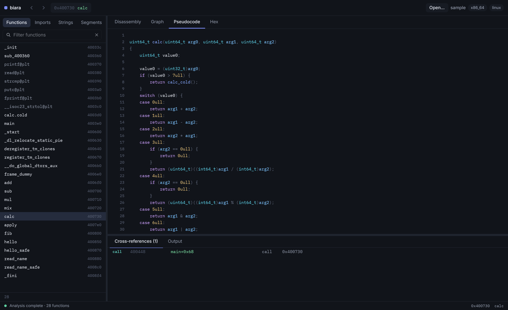
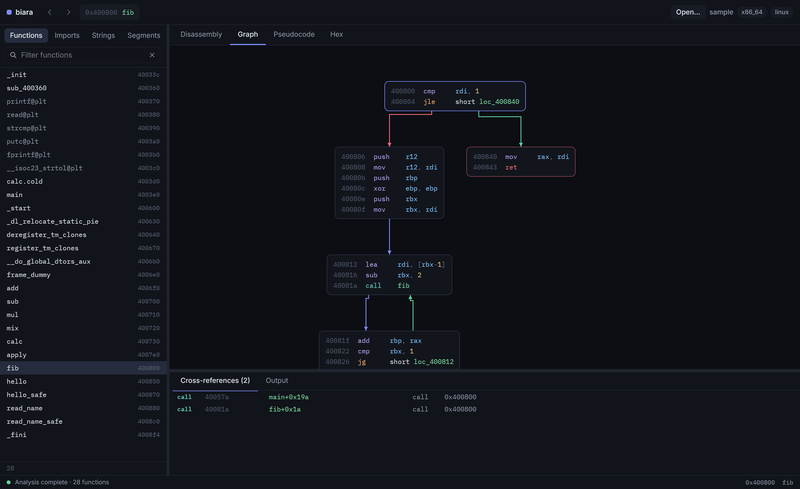
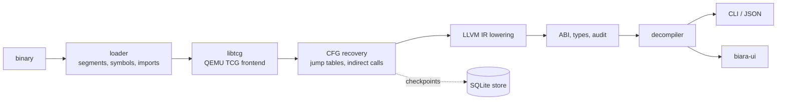

<h1 align="center">biara</h1>

<p align="center">
  <b>A binary analyser built on QEMU's lifter and LLVM.</b><br>
  Machine code in; control flow, calling conventions, types and readable C out.
</p>

<p align="center">
  
</p>

biara reads an executable, lifts its machine code through **QEMU's TCG frontends** into **LLVM
IR**, and recovers what a reverse engineer wants from it: functions and basic blocks, jump
tables and indirect-call targets, stack frames and calling conventions, struct layouts, and
decompiled C. You can drive it from the **command line** (JSON for scripts and agents) or from
a **desktop workbench** in the spirit of IDA, drawn on the GPU.

Because the lifting is QEMU's, instruction semantics come from the same code that runs real
guests rather than from a hand-written model.

- **Formats:** ELF, PE (including DLL exports, TLS callbacks, Guard CF tables) and Mach-O
- **Architectures:** x86-64 and AArch64
- **Recovery:** jump tables, indirect-call candidates with exhaustiveness, unwind and
  function-start tables, code pointers, exports, DWARF names and parameters
- **Analyses:** ABI and stack frames, inferred struct layouts and typed signatures, call
  arguments at imports, and a security audit (format strings, writes past a frame)
- **Resumable:** recovery commits to a content-addressed SQLite store; interrupt a run and rerun
  the same command to continue, reopen a binary and it is ready in seconds
- **Names:** C++ (Itanium, MSVC) and Rust (legacy, v0) symbols are demangled in the UI

## See it work

`examples/sample` is a small program with a jump table, a table of function pointers, a
recursive function and two deliberate bugs. Build it and ask biara about it (`biara` here is
`target/release/biara`; `cargo run --release -p biara-cli --` works in its place):

```sh
examples/sample/build.sh                      # -> target/sample/sample
biara lift target/sample/sample --emit audit
```

```text
0x400856 in 0x400850 <hello>: printf: format string (argument 0) comes from the command line: [rsi@entry+0x10] in 0x4003e0 <main>; via 0x400528 in 0x4003e0 <main>
0x40088e in 0x400880 <read_name>: read: writes up to 0x40 bytes to sp-0x18, past the caller's frame
```

Those are the two planted bugs and nothing else. The `calc` function is a `switch` compiled to
a jump table; biara finds all eight targets and emits it as one:

```sh
biara lift target/sample/sample calc --emit decomp
```

```c
uint64_t calc(uint64_t arg0, uint64_t arg1, uint64_t arg2)
{
    uint64_t value0;

    value0 = (uint32_t)arg0;
    if (value0 > 7ull) {
        return -1ull;
    }
    switch (value0) {
    case 0ull:
        return arg1 + arg2;
    case 1ull:
        return arg1 - arg2;
    case 2ull:
        return arg2 * arg1;
    case 3ull:
        if (arg2 == 0ull) {
            return 0ull;
        }
        return (uint64_t)((int64_t)arg1 / (int64_t)arg2);
    /* ... cases 4 to 7 ... */
    }
}
/* Analysis evidence:
 * ABI: converged; frame 0 bytes; balanced true; unknown SP blocks []
 * indirect at 0x40073c: candidates [4196168,4196176,...]; exhaustive true
 */
```

Every result carries its evidence, so you can tell a proven fact from a guess.

## Install

Linux x86-64 is the host. The toolchain is pinned and fetched for you:

| Piece | Version | Where it comes from |
| --- | --- | --- |
| QEMU | 11.1.2 | downloaded by `scripts/fetch-deps.sh`, patched and built as `libtcg-<arch>.so` |
| LLVM | 23.1.2 | prebuilt release, unpacked into `.deps/` (several GB) |
| Rust | recent stable (edition 2024) | your `rustup` |

You also need what QEMU's build needs: Python 3, `ninja`, glib development headers, plus `curl`
and `zstd`.

```sh
scripts/fetch-deps.sh                 # download and verify QEMU and LLVM into .deps/
scripts/build-libtcg.sh               # build the lifters (x86_64 and aarch64; pass names for one)
cargo build --release                 # target/release/biara and target/release/biara-ui
```

`.cargo/config.toml` points the build at `.deps/`, so `cargo run` and `cargo test` just work.
To run a built binary directly, tell it where the lifters are:

```sh
export BIARA_LIBTCG_DIR=$PWD/.deps/out
```

## Command line

```sh
biara lift  <BINARY> [ADDR|NAME...] --emit <KIND> [--format text|json|jsonl]
biara diff  <OLD> <NEW>                # match functions between two builds by their code
biara quality <REFERENCE> <CANDIDATE>  # function and edge recall vs. a symbol-bearing oracle
biara worker [JOB.json]                # run one JSON job (for hosting the engine)
```

`lift` takes optional start points (an address or a symbol); with none it analyses the whole
program from the entry point, symbols, exports and unwind tables.

| `--emit` | You get |
| --- | --- |
| `llvm` (default) | LLVM IR, textual; `-O1`..`-O3` optimise it, `--link-helpers` inlines QEMU's helpers |
| `tcg` | QEMU's TCG ops per translation block |
| `c` | Compilable C with recovered calling conventions and stack frames |
| `decomp` | Readable function bodies, dependencies and the evidence behind them |
| `cfg` | Functions, blocks and their exits |
| `abi` | Per function: frame, register arguments, return values, clobbers |
| `calls` | Calls to imports and what their arguments hold |
| `types` | Inferred struct layouts and typed signatures |
| `audit` | Non-constant format strings and writes past declared objects |

Useful flags: `--database` (resume file), `--jobs`, `--memory-mib` (analysis budget, default
4096), `--annotations` (your names, signatures and struct layouts, JSON or TOML), and
`--format json|jsonl` for a versioned schema with numeric addresses.

## Desktop workbench

```sh
cargo run --release -p biara-ui -- /path/to/binary
cargo run --release -p biara-ui                  # empty window: Open…, or drop a file on it
```

<p align="center">
  
</p>

| View | What it shows |
| --- | --- |
| Disassembly | Every recovered instruction, with function headers, labels with their incoming jumps, string and symbol annotations, clickable targets |
| Graph | The function's basic blocks as boxes with typed edges (taken, not taken, plain, jump-table case); pan and zoom |
| Pseudocode | Decompiled C; calls and globals link to their targets, renames apply instantly |
| Hex | The mapped image as 16-byte rows; works before analysis finishes |

The sidebar lists functions, imports, strings and segments, each filterable; the bottom panel
shows cross-references. `G` goes to an address or name, `N` renames, `X` shows references,
`Space` flips between disassembly and graph, `F5` opens pseudocode, `Ctrl+K` opens a command
palette. It stays at 0% CPU when idle. See [`crates/biara-ui/README.md`](crates/biara-ui/README.md)
for every key, the architecture and the headless testing options.

## How it works



Recovery runs in isolated worker processes, so a crash or runaway in one does not take the
engine down, and it commits translated blocks to the store as it goes. That is what makes a run
resumable and a reopen cheap. (There is no sandbox: biara never executes the binary, but its
bytes do pass through QEMU's frontends, so treat hostile input accordingly.)

| Crate | Role |
| --- | --- |
| `libtcg-sys`, `biara-tcg` | Runtime-loaded bindings to `libtcg-<arch>.so` and a safe TCG IR |
| `biara-loader` | ELF, PE and Mach-O: segments, symbols, imports, function starts, DWARF |
| `biara-cfg` | Control-flow recovery over translation blocks |
| `biara-abi` | Stack frames and calling conventions |
| `biara-lift` | TCG to LLVM IR lowering, analyses, type inference, C and decompiler output |
| `biara-engine` | Persistent, process-isolated recovery with a memory budget |
| `biara-diff` | Function matching between two binaries |
| `biara-proto` | Shared formats: annotations, job bundles, diff results |
| `biara-cli` | The `biara` command |
| `biara-ui` | The desktop workbench, on [Rune](https://github.com/anomalyco/rune) |

`libtcg/` and `patches/` hold the small patch that turns QEMU's translator into a library.

## Performance

Cold run, release build, 6-core desktop CPU, default settings:

| Binary | Size | Work | Time |
| --- | --- | --- | --- |
| `/usr/bin/ls` | 150 KB | `--emit cfg` | 0.5 s |
| `/usr/bin/bash` | 1.5 MB | `--emit cfg` | 5 s |
| glibc (`libc.so.6`) | 2.5 MB | open in the UI, 319k instructions | about 15 s cold, about 4 s on reopen |

Very large binaries (tens of MB) can take a long time and a lot of memory. `--memory-mib` caps
the analysis and the store lets an interrupted run resume.

## Limits

biara is young.

- Mach-O loads on the command line but has not been exercised in the UI.
- The graph view handles functions up to 1,500 blocks; larger ones use the other views.
- Renames cover functions and named data, not locals or struct fields.
- Recovery sometimes lifts a stray non-code byte (94 in all of glibc); the listing shows `db`.
- The host is Linux x86-64; guests are x86-64 and AArch64.

## Tests

```sh
cargo test --workspace
BIARA_UI_BIG=/usr/lib64/libc.so.6 cargo test -p biara-ui --release --test backend -- --ignored --nocapture
```

The tests build real programs with the pinned clang and analyse them end to end, including
AArch64 cross-builds, a Windows DLL, a freestanding C++ and a `no_std` Rust binary. The UI tests
drive the app through Rune's headless runtime with typed keys and clicks.

## License

biara is [MIT](LICENSE) licensed, with one exception that matters if you distribute builds:
QEMU is GPL, so the patch in `patches/` is GPL-2.0-or-later, and the `libtcg-<arch>.so` and
helper bitcode it produces are GPL binaries. The Rust code only loads them at run time. Details
in [`patches/README.md`](patches/README.md) and
[`THIRD_PARTY_NOTICES.md`](THIRD_PARTY_NOTICES.md).
